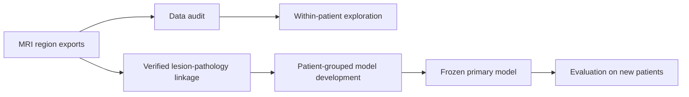

# Prostate MRI: From Quantitative Features to Pathology-Linked Prediction

## Why this project exists

Prostate MRI can yield hundreds of thousands of numeric measurements, but a model intended for new patients is supported by the number of **independent patients and pathology-matched lesions**, not the number of exported image values. This project asks what can be learned from a small, preprocessed MRI cohort now, and builds a reproducible path to a future cancer-prediction study without overstating performance.

The scientific story has two stages:

1. **Current evidence:** compare quantitative MRI measurements in annotated lesions with annotated healthy tissue from the same patient and anatomical zone.
2. **Future clinical question:** test whether a small set of lesion-level MRI features predicts a clearly defined pathology outcome in entirely new patients.

This repository is a research workflow, not a clinical decision tool. Pathology-linked modeling and new-patient validation have **not** been completed.



## What the current data show

The available export covers **3 patients (P1–P3)**, four region types (`Lesion_PZ`, `Lesion_CG`, `Healthy_PZ`, `Healthy_CG`), and five MRI maps (`ADC`, `T1`, `T2`, `PBF`, `T2W`). Twelve region CSVs contain **704,142 values**. Three summary CSVs report per-patient, per-region statistics. An automated audit found **zero count mismatches** between the raw and summary files.

Four patient-zone pairs have at least 20 values in both the lesion and same-zone healthy region for ADC and T2. In all four pairs, the lesion median was lower than the corresponding healthy-region median. The median lesion-minus-healthy differences were **−394.8 × 10⁻⁶ mm²/s for ADC** and **−9.0 ms for T2**. These are descriptive, MRI-annotation-based observations from three patients. They are **not** estimates of cancer-diagnosis accuracy or population effects. The local analysis generates a paired figure and a detailed result summary under `outputs/`.

| Data limitation | Implication |
| --- | --- |
| Three independent patients | Generalization to new patients cannot be estimated reliably. |
| `Lesion_PZ` is empty for P2; P3 has only four `T2W` values there | Peripheral-zone lesion evidence is sparse. |
| Pathology-positive and pathology-negative lesion labels are held separately | They cannot yet be linked to the supplied CSV rows. |
| Region CSVs lack lesion IDs, voxel coordinates, and cross-map keys | A source-to-pathology match must be confirmed; raw values from different maps cannot be joined into aligned voxel samples. |
| “Healthy” identifies an imaging annotation | It is not automatically a pathology-confirmed negative case. |

## Methods and design choices

- **Independent evaluation group:** patient. All lesions from one patient stay together in every split.
- **Exploratory comparison:** within-patient, same-zone region medians, with at least 20 values in each compared region-map. This display rule is not a sample-size justification.
- **Proposed prediction row:** one lesion with an explicit pathology result and a verified match to one MRI region export. If a region pools multiple lesions, the export must be replaced with lesion-specific features.
- **Planned pilot features:** lesion-to-same-zone-healthy median ratios for ADC and T2, plus anatomical zone. These are region-level features, not aligned voxel-level features.
- **Planned primary model:** regularized logistic regression. Three-neighbor KNN and a shallow decision tree are secondary benchmarks. The software refuses to run the pilot on the present three-person cohort. Its six-patient minimum is only a technical guard, not proof of an adequate study size.
- **Evaluation:** leave-one-patient-out internal evaluation during development; a frozen primary model evaluated later on entirely new patients. Internal results and external results are kept separate. Preprocessing occurs inside the training folds, following [scikit-learn's leakage guidance](https://scikit-learn.org/stable/common_pitfalls.html) and [grouped-validation guidance](https://scikit-learn.org/stable/modules/cross_validation.html).

Full decisions, assumptions, and limitations are recorded in the [study protocol](docs/study_protocol.md). The [data dictionary](docs/data_dictionary.md) specifies the MRI fields and the private pathology-linkage requirements.
An [application summary](docs/application_summary.md) gives a concise description and a resume bullet that reflect the project's current stage.

## Repository contents

```text
src/prostate_mri/audit.py       Raw/summary count and value audit
src/prostate_mri/explore.py     Paired descriptive analysis and figure
src/prostate_mri/features.py    Guarded pathology-to-MRI feature builder
src/prostate_mri/modeling.py    Grouped pilot models and new-patient evaluator
tests/test_workflow.py          Synthetic tests for counts, matching, and leakage guards
docs/                         Study protocol and data dictionary
data/lesion_linkage_template.csv  Empty schema, not real pathology data
outputs/                      Local generated results; ignored by Git
```

The 15 original patient-derived CSV files remain in the local project directory but are excluded from version control by `.gitignore`. Local `outputs/` and private linkage files are also excluded.

## Reproduce the current analysis

Use Python 3.10 or later. On Windows PowerShell, run the following from the repository root. Every installation stays inside the project-local `.venv` directory:

```powershell
python -m venv .venv
.\.venv\Scripts\python.exe -m pip install -e .
.\.venv\Scripts\python.exe -m prostate_mri.audit --data-dir . --output outputs/audit.json
.\.venv\Scripts\python.exe -m prostate_mri.explore --data-dir . --output-dir outputs
.\.venv\Scripts\python.exe -m unittest discover -s tests -v
```

The audit writes `outputs/audit.json` and `outputs/audit_summary.md`; the exploratory run writes `outputs/paired_contrasts.csv`, `outputs/adc_t2_paired.png`, and `outputs/exploratory_results.md`. These outputs require access to the source CSVs and are not public artifacts by default.

## When pathology linkage and more patients are available

Copy the columns in `data/lesion_linkage_template.csv` into an access-controlled file under `data/private/`. `pathology_label` must be `0` or `1`, with the exact outcome definition set in advance. Confirm `roi_to_lesion_match=true` only after checking that the imaging region represents that specific pathology lesion. Then run:

```powershell
.\.venv\Scripts\python.exe -m prostate_mri.features --data-dir . --linkage data/private/lesion_linkage.csv --output outputs/lesion_features.csv
.\.venv\Scripts\python.exe -m prostate_mri.modeling develop --features outputs/lesion_features.csv --outcome-definition "YOUR PREDEFINED PATHOLOGY OUTCOME" --output-dir outputs/model
```

The development command generates grouped internal predictions, an evaluation report, a fitted primary model, and a manifest containing the outcome definition, feature list, threshold, and development patient IDs. It intentionally stops with the current three-patient cohort. After freezing the model and acquiring lesion features from **new patients**, evaluate them with:

```powershell
.\.venv\Scripts\python.exe -m prostate_mri.modeling external --features outputs/new_patient_features.csv --model-dir outputs/model --output-dir outputs/external
```

The evaluator rejects any patient ID that overlaps with development. New-patient features must be created with the same documented definitions and preprocessing.

## Interpretation and next steps

The present deliverable is a transparent exploratory MRI analysis and a guarded, tested modeling workflow. The next scientific gate is the lesion-to-pathology crosswalk, followed by additional independent patients and a sample-size plan based on the chosen outcome. A future report should include discrimination, error types, calibration, uncertainty, and relevant subgroup results when the data support them. Reporting will follow [TRIPOD+AI](https://www.bmj.com/content/385/bmj-2023-078378), with risk-of-bias review using [PROBAST+AI](https://www.bmj.com/content/388/bmj-2024-082505).

Before publishing patient-derived source files, figures, or numeric outputs, confirm data-sharing permission and review potential re-identification risk. The repository can be shared as code and documentation while the clinical data remain private.
